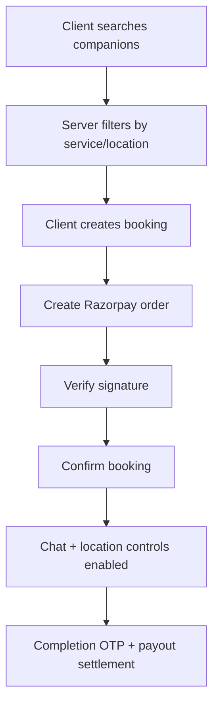
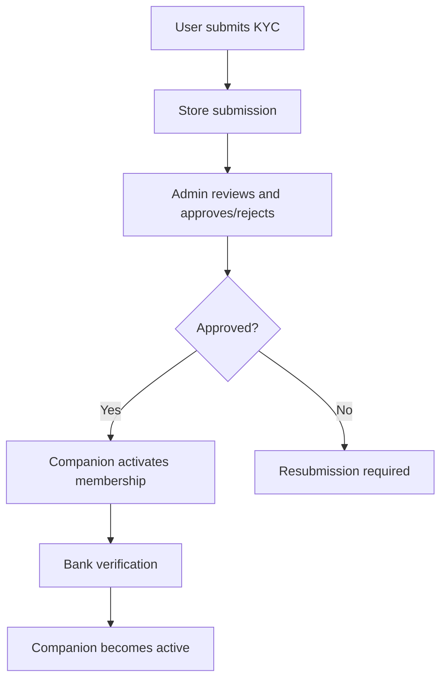
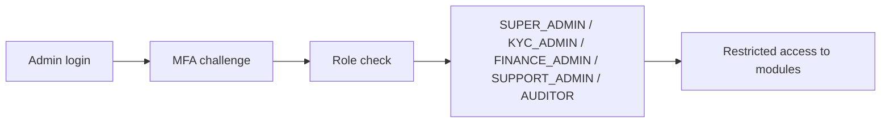

# Complete System Blueprint

## 1. System overview
PairUpToday is a multi-role companion services platform with three major surfaces:
- the public website
- the client/companion app experience
- the independent admin portal

The actual implementation is centered in:
- [src/App.tsx](../../src/App.tsx) for routing and page selection
- [src/admin/AdminPortal.tsx](../../src/admin/AdminPortal.tsx) for the independent admin portal
- [server.ts](../../server.ts) for the backend Express API and business logic
- [supabase/migrations/001_initial_schema.sql](../../supabase/migrations/001_initial_schema.sql) for the canonical database schema
- [server/services/*.ts](../../server/services) for integrations

## 2. Website navigation and user-facing pages
### Public website pages implemented
| Page | Source | User-facing behavior |
|---|---|---|
| Home | [src/App.tsx](../../src/App.tsx), [src/components/Hero.tsx](../../src/components/Hero.tsx) | landing page, service selection, companion discovery CTA |
| About | [src/pages/AboutPage.tsx](../../src/pages/AboutPage.tsx) | brand and platform explanation |
| How It Works | [src/pages/HowItWorksPage.tsx](../../src/pages/HowItWorksPage.tsx) | steps for client and companion onboarding |
| Safety & Trust | [src/pages/SafetyTrustPage.tsx](../../src/pages/SafetyTrustPage.tsx) | safety policy and trust messaging |
| Client dashboard | [src/pages/ClientDashboard.tsx](../../src/pages/ClientDashboard.tsx) | booking, profile and service access |
| Companion dashboard | [src/pages/CompanionDashboard.tsx](../../src/pages/CompanionDashboard.tsx) | profile, availability, activation, bookings |
| Admin portal | [src/admin/AdminPortal.tsx](../../src/admin/AdminPortal.tsx) | isolated admin portal under admin host routing |

### Website route behavior
The frontend routes are not a full React Router setup; instead the app uses local state switching in [src/App.tsx](../../src/App.tsx):
- `/about`
- `/how-it-works`
- `/safety-trust`
- `/admin`
- home route default layout

### Public discovery flow
The app loads service categories and a companion listing component from:
- [src/components/ServicesGrid.tsx](../../src/components/ServicesGrid.tsx)
- [src/components/CompanionListing.tsx](../../src/components/CompanionListing.tsx)

## 3. Client registration and login journey
Implemented in:
- [src/context/AuthContext.tsx](../../src/context/AuthContext.tsx)
- [src/pages/AuthGatewayModal.tsx](../../src/pages/AuthGatewayModal.tsx)
- [server.ts](../../server.ts)

### Client auth flow
- check phone registration: `/api/auth/check-phone`
- request OTP: `/api/auth/request-otp`
- register with OTP: `/api/auth/register-with-otp`
- verify OTP: `/api/auth/verify-otp`
- login: `/api/auth/login`
- role selection: `/api/auth/select-role`

Status: PARTIAL. The flow is implemented locally with OTP and password handling, but it depends on real provider credentials for live SMS and production authentication.

## 4. Companion registration, KYC, membership and activation
Source files:
- [src/pages/KycWizardModal.tsx](../../src/pages/KycWizardModal.tsx)
- [src/pages/RoleSelectionModal.tsx](../../src/pages/RoleSelectionModal.tsx)
- [server.ts](../../server.ts)
- [supabase/migrations/001_initial_schema.sql](../../supabase/migrations/001_initial_schema.sql)

### Companion journey
1. User selects role as COMPANION.
2. User submits KYC through `/api/kyc/submit`.
3. Companion sets service prices and availability via `/api/companion/services-rates` and `/api/companion/availability/toggle`.
4. Membership subscription is configured via `/api/companion/membership/subscribe`.
5. Bank verification is attempted via `/api/companion/bank/verify`.
6. Activation requires KYC approval, active membership, and successful bank verification.

### Implementation status
- Local logic exists and is validated in the production-readiness test harness.
- Live KYC document review, supplier approval, and external verification remain external-blocked.

## 5. Independent Admin Portal and role model
Admin portal implementation:
- [src/admin/AdminPortal.tsx](../../src/admin/AdminPortal.tsx)
- [src/context/AdminAuthContext.tsx](../../src/context/AdminAuthContext.tsx)
- [server.ts](../../server.ts)

### Roles present
- SUPER_ADMIN
- KYC_ADMIN
- FINANCE_ADMIN
- SUPPORT_ADMIN
- AUDITOR

Evidence: [supabase/migrations/001_initial_schema.sql](../../supabase/migrations/001_initial_schema.sql) and [server.ts](../../server.ts) define the exact five-role model.

### Admin auth flow
- `/api/admin/login`
- `/api/admin/verify-mfa`
- role-gated endpoints via `requireAdminRoles()`

Status: PARTIAL. Role gating exists locally, but the live admin accounts and provider-backed MFA setup remain unconnected.

## 6. Booking lifecycle
Source: [server.ts](../../server.ts)

Major endpoints:
- `/api/companions/search`
- `/api/bookings/create`
- `/api/payments/razorpay/create-order`
- `/api/payments/razorpay/verify-payment`
- `/api/payments/razorpay/webhook`

### Booking flow in code
1. Client searches for companions within a service/location filter.
2. Backend matches companions and returns candidates.
3. Client creates a booking.
4. Payment order is created through Razorpay wrapper.
5. Payment signature is verified on server.
6. Booking status is confirmed.
7. Chat and location-sharing metadata become available for authorized participants.

Status: PARTIAL. The logic exists locally, but live provider verification and real production payments are not configured.

## 7. Chat and location sharing lifecycle
### Chat
Implemented in:
- [server.ts](../../server.ts)
- [supabase/migrations/001_initial_schema.sql](../../supabase/migrations/001_initial_schema.sql)

Endpoints:
- `/api/support/conversation`
- `/api/support/message`
- `/api/admin/support/conversations`
- `/api/admin/support/reply`

### Location sharing
Sources:
- [server/services/firebase.ts](../../server/services/firebase.ts)
- [server.ts](../../server.ts)

Endpoints:
- `/api/location/update`
- `/api/location/sharing/start`
- `/api/location/sharing/stop`
- `/api/presence`

Status: PARTIAL. Local logic and schema exist, but Firebase RTDB is not configured in production.

## 8. OTP and verification workflows
OTP and verification logic is implemented in:
- [server.ts](../../server.ts)
- [server/services/apitxt.ts](../../server/services/apitxt.ts)

### OTP rules present
- six-digit OTP
- HMAC-SHA256 storing and verification
- max attempts / expiry / cooldown logic
- server-side secret use

Status: PARTIAL. The logic is present and validated locally; APITXT live dispatch is blocked by missing API keys.

## 9. Payment, commission, wallet and settlement
Financial rules are encoded in:
- [server.ts](../../server.ts)
- [server/services/razorpay.ts](../../server/services/razorpay.ts)
- [supabase/migrations/001_initial_schema.sql](../../supabase/migrations/001_initial_schema.sql)

### Rules modeled in code
- client membership is free
- companion membership remains paid
- platform fee 15%
- companion share 85%
- delay penalty formula: `(Booking Amount / Slot Minutes) * Delay Minutes`
- settlement lock minimum 48 hours
- integer paise accounting
- idempotent payout processing

Status: PARTIAL. Local model is complete and validated, but the live Razorpay payment gateway is not connected.

## 10. Database architecture
See [DATABASE_ARCHITECTURE.md](./DATABASE_ARCHITECTURE.md).

## 11. Backend and API architecture
Backend server is a single Express app in [server.ts](../../server.ts) with route-level auth checks and business logic. Key responsibilities:
- auth and session handling
- OTP issuance and verification
- KYC capture and status transitions
- companion profile and membership lifecycle
- booking and payment orchestration
- admin role authorization
- support conversation handling
- location and presence updates
- external provider wrappers for Firebase, Supabase, Maps, APITXT, Razorpay

## 12. Firebase, Supabase and Google Maps roles
### Firebase
- RTDB for presence and location tracking
- FCM for push notifications
- source: [server/services/firebase.ts](../../server/services/firebase.ts), [server/services/fcm.ts](../../server/services/fcm.ts)

Status: PARTIAL / EXTERNAL BLOCKED

### Supabase
- canonical database schema
- RLS policies
- query helper client
- source: [server/services/supabase.ts](../../server/services/supabase.ts), [supabase/migrations/001_initial_schema.sql](../../supabase/migrations/001_initial_schema.sql), [supabase/migrations/002_rls_policies.sql](../../supabase/migrations/002_rls_policies.sql)

Status: PARTIAL / EXTERNAL BLOCKED

### Google Maps
- autocomplete, geocoding, reverse geocoding, distance calculations
- source: [server/services/googlemaps.ts](../../server/services/googlemaps.ts)

Status: PARTIAL / EXTERNAL BLOCKED because API keys are absent.

## 13. Android and iOS app architecture
- Android manifest: [android/app/src/main/AndroidManifest.xml](../../android/app/src/main/AndroidManifest.xml)
- iOS plist: [ios/App/App/Info.plist](../../ios/App/App/Info.plist)

Capabilities present:
- camera + gallery permissions
- location permissions
- internet access
- network security config

Status: PARTIAL. Project structure exists but native app release and provider integration remain uncompleted.

## 14. Mermaid diagrams
### Booking and payment flow

### KYC and activation flow

### Admin model

## 15. Conclusion
PairUpToday is a complete local platform blueprint and a substantial local implementation scaffold, but it is not a live production system yet. The codebase demonstrates a realistic architecture and a strong local validation baseline. Actual external provider connectivity and deployment remain the remaining blockers.
