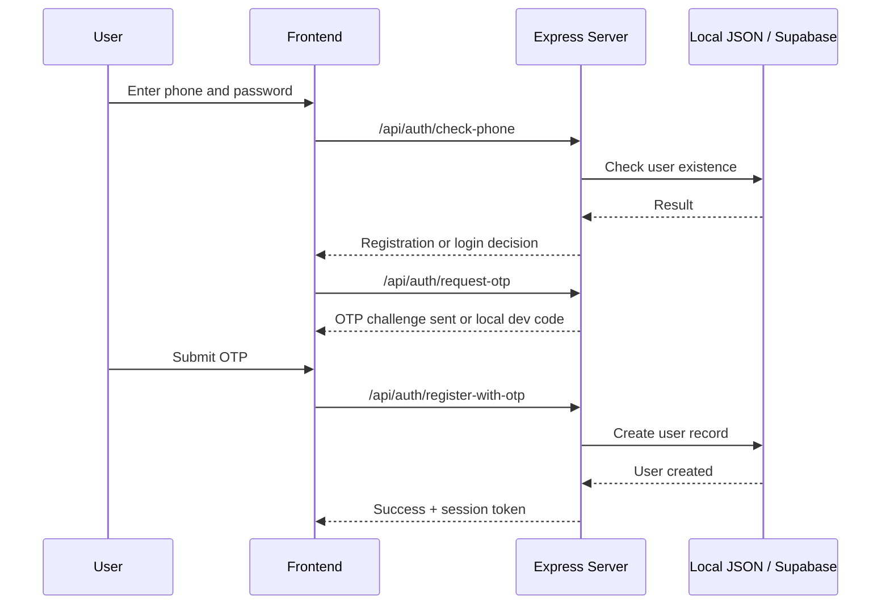
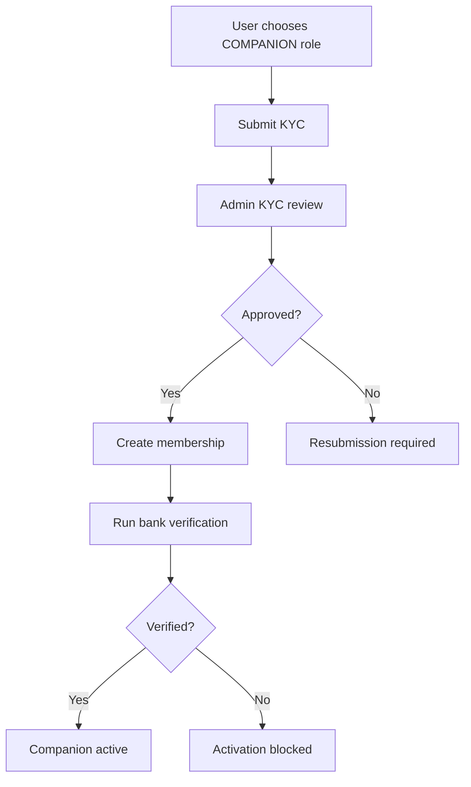
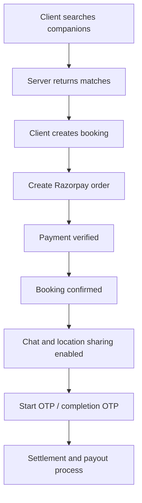
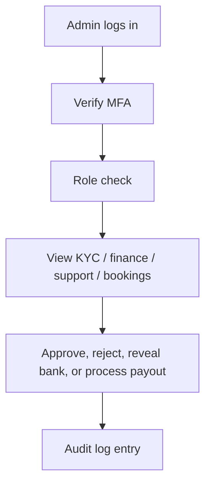
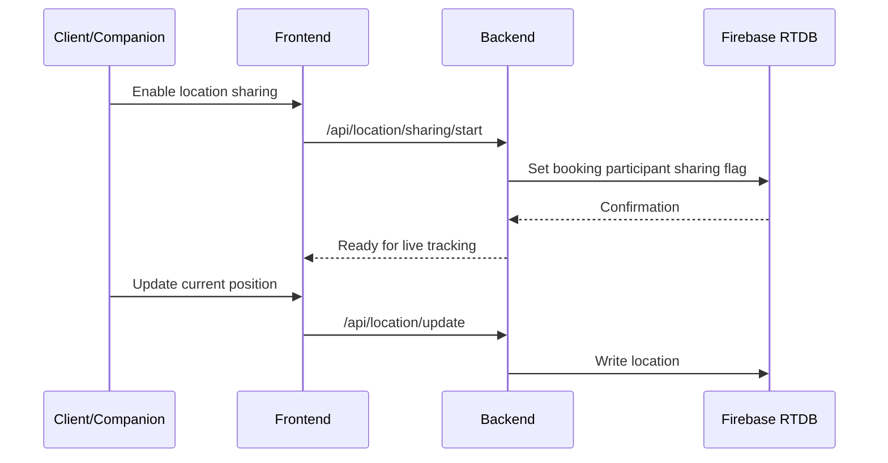
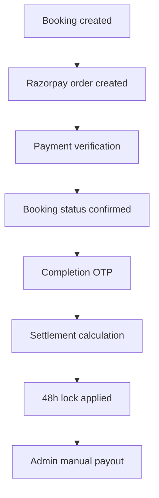

# System Flow Diagrams

## 1. Client registration flow

## 2. Companion activation flow

## 3. Booking lifecycle

## 4. Admin review workflow

## 5. Location sharing flow

## 6. Payment and settlement flow

