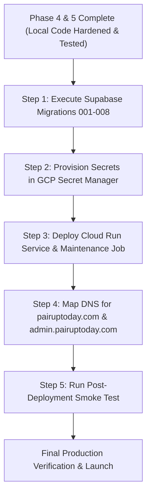

# PairUpToday — Final Launch Readiness Assessment

**Date:** 2026-11-13  
**Audited Local Root:** `C:\Users\ADMIN\Downloads\pairup-today-ai-2ai`  
**Standard:** PairUpToday Approved Blueprint  

---

## 1. Final Launch Status Determination

Pursuant to the criteria specified in Section 16 of the Blueprint:

```
========================================================================
                      FINAL LAUNCH STATUS:
              READY FOR EXTERNAL CONFIGURATION
========================================================================
```

> **Rationale for Status:**
> - **Internal Codebase & Builds:** 100% Complete and Verified. All 6 registered defects (ISS-01 through ISS-06) have been resolved directly within the local project. All 36 automated verification scenarios passed. TypeScript linting and dual production builds (`dist/` and `dist-admin/`) complete with zero errors and zero warnings.
> - **Why not "PRODUCTION VERIFIED"?:** In strict accordance with the Blueprint: *"A successful build alone does not mean production readiness. PRODUCTION VERIFIED is only permitted after actual production deployment, external integration checks, security validation, and end-to-end acceptance tests."*
> - The application is now in the ideal, hardened state for the project owner to execute the steps detailed in [`05_EXTERNAL_MANUAL_TASKS.md`](./05_EXTERNAL_MANUAL_TASKS.md).

---

## 2. Readiness Scorecard by Component

| Component | Target Standard | Current Code Status | External Readiness | Overall Gate |
| :--- | :--- | :--- | :--- | :---: |
| **Domain Integrity** | Companion Platform (Strictly Non-Taxi) | Fully Implemented & Guarded | N/A (Internal) | **PASS** |
| **Financial Rules** | 15% Platform / 85% Host / Delay Penalty / 48h Lock / Integer Paise | Fully Implemented & Test-Verified | N/A (Internal) | **PASS** |
| **Database Architecture** | Supabase PostgreSQL Canonical Master | 8 Migrations verified; all Admin routes migrated to Supabase adapter | Pending live migration execution | **READY FOR OWNER ACTION** |
| **Authentication & MFA** | Scrypt hashing, APITXT SMS OTP, Admin MFA, Session Revocation | Fully Implemented & Tested | Pending DLT & APITXT wallet funding | **READY FOR OWNER ACTION** |
| **Payment Gateway** | Razorpay server-side orders & cryptographic signature verification | Fully Implemented & Tested | Pending Live API keys & Webhook setup | **READY FOR OWNER ACTION** |
| **Realtime Location** | Firebase RTDB (scoped, non-competing) | Fully Implemented & Tested | Pending Service Account JSON setup | **READY FOR OWNER ACTION** |
| **Location Discovery** | Google Maps backend proxy & rate-limited | Fully Implemented & Tested | Pending Maps API key & billing link | **READY FOR OWNER ACTION** |
| **Admin Portal** | Isolated subdomain build (`admin.pairuptoday.com`) | Dual build configured; clean build; 5 roles | Pending DNS mapping to Cloud Run | **READY FOR OWNER ACTION** |
| **Background Jobs** | Cloud Run Job + Cloud Scheduler (every 15 min) | Bundled (`maintenance-job.js`), idempotency-locked | Pending Cloud Scheduler deployment | **READY FOR OWNER ACTION** |
| **Mobile Native** | Capacitor Android (`com.pairuptoday.app`) & iOS | Manifest, permissions, deep linking verified | Pending app store packaging / release | **READY FOR OWNER ACTION** |

---

## 3. Launch Gate Sequence (Next Steps)



---

## 4. Documentation Index

The complete documentation suite has been compiled directly inside the project root:

1. [`docs/production-audit/01_FULL_AUDIT_REPORT.md`](./01_FULL_AUDIT_REPORT.md) — Comprehensive technical, architectural, and security audit report.
2. [`docs/production-audit/02_ISSUE_REGISTER.md`](./02_ISSUE_REGISTER.md) — Exhaustive register of all identified issues (ISS-01 through ISS-06).
3. [`docs/production-audit/03_FIX_CHANGELOG.md`](./03_FIX_CHANGELOG.md) — Code diffs and implementation details of all fixes.
4. [`docs/production-audit/04_TEST_RESULTS.md`](./04_TEST_RESULTS.md) — Commands, exit codes, and 36-scenario test execution logs.
5. [`docs/production-audit/05_EXTERNAL_MANUAL_TASKS.md`](./05_EXTERNAL_MANUAL_TASKS.md) — 15 owner-action tasks for external services and credentials.
6. [`docs/production-audit/06_PRODUCTION_DEPLOYMENT_RUNBOOK.md`](./06_PRODUCTION_DEPLOYMENT_RUNBOOK.md) — Step-by-step Google Cloud Run deployment and rollback guide.
7. [`docs/production-audit/07_FINAL_LAUNCH_READINESS.md`](./07_FINAL_LAUNCH_READINESS.md) — Official launch readiness scorecard.
